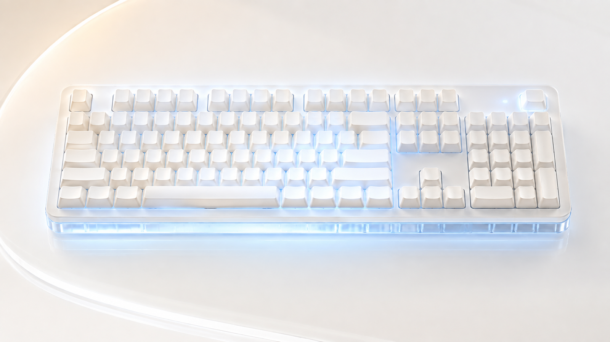

<div align="center">

# Keyboard Logo Fix

在 macOS 上恢复 SCC100、FMate98 键盘的自定义 LOGO 灯效。

**简体中文** · [English](README.en.md)

</div>



部分 HID 键盘连接到 Mac 后，macOS 会向键盘写入绿色指示灯状态，覆盖键盘上已保存的
LOGO 灯效。Keyboard Logo Fix 只负责解除这一覆盖，使键盘恢复为已保存的灯效。它不设置
颜色或动画，恢复的始终是键盘中存储的灯效。

## 支持的键盘

- SCC100：已实机测试
- FMate98：经用户反馈可用

两者使用相同的 HID 标识和输出报告协议：

| 连接方式 | VID:PID | 说明 |
| --- | --- | --- |
| USB 有线 | `258A:010C` | |
| 蓝牙（BLE） | `3554:FA07` | 系统里可能显示为 `T100 5.0` |

`T100` 是键盘主控向 macOS 上报的名称，并非键盘型号。VID/PID 和报告协议相同的其他
键盘通常也可以使用，但尚未经过实机验证。标识或协议不同的设备不会被识别。

## 安装

使用 Homebrew：

```sh
brew install --cask hoobnn/tap/keyboard-logo-fix
```

也可以从 [Releases](../../releases) 下载最新的
`Keyboard-Logo-Fix-<版本号>-macOS.zip`：

1. 解压后将 **Keyboard Logo Fix.app** 拖入“应用程序”（通过 Homebrew 安装可跳过此步）；
2. 打开 App，选择连接方式：自动、USB 或蓝牙；
3. 如果首次打开被 macOS 拦截，前往**系统设置 → 隐私与安全性**点击**仍要打开**；
4. 在**系统设置 → 隐私与安全性 → 输入监控**中允许该 App，然后重新打开。

### 从 0.1.x 升级

新版首次启动时会停止并删除旧的 `local.codex.t100-logo-white` 后台服务，旧版保存的
连接方式会继续沿用。旧的 `T100 Logo 白色呼吸.app` 不会被自动删除，需手动移到废纸篓。

## 工作原理

首次打开 App 时，会安装一个用户级 LaunchAgent：

```text
~/Library/LaunchAgents/com.ikuyu.keyboard-logo-fix.plist
```

后台程序随登录启动，平时保持空闲，只监听两类事件：兼容键盘接入和 Mac 唤醒。
以下三种情况会触发一轮恢复报告：

- 后台服务启动；
- 兼容键盘连接或重新连接；
- Mac 从睡眠中唤醒。

每轮每 50 ms 发送一次，持续约 3 秒，共约 60 次。连续发送是因为键盘初始化期间
macOS 可能再次写入绿色指示状态，单次发送容易被覆盖。报告只解除指示灯覆盖，
灯效仍是键盘中存储的那一套。

程序不刷固件、不改键位、不记录按键，也不联网。

连接偏好和日志位于：

```text
~/Library/Application Support/KeyboardLogoFix/preferred-connection
~/Library/Logs/KeyboardLogoFix.log
```

## 命令行

```sh
./keyboard-logo-fix             # 安装后台服务并选择连接方式
./keyboard-logo-fix 10          # 手动发送 10 秒（范围 1–300）
./keyboard-logo-fix --daemon    # 在前台运行后台服务
./keyboard-logo-fix --uninstall # 卸载新版和 0.1.x 的后台服务
./keyboard-logo-fix --help      # 查看用法
```

卸载命令只移除后台服务，App、连接偏好和日志会保留。

## 从源码构建

需要 Xcode Command Line Tools。默认构建 Apple Silicon 与 Intel 通用二进制：

```sh
make            # 构建 ./keyboard-logo-fix
make test       # 运行单元测试
make app        # 打包 dist/Keyboard Logo Fix.app
make clean
```

`com.ikuyu.keyboard-logo-fix.plist` 是手动配置用的 LaunchAgent 模板，适用于 App
已经放在“应用程序”文件夹的情况。

### 源码结构

| 文件 | 职责 |
| --- | --- |
| `src/main.c` | 解析命令行参数，分发到各入口 |
| `src/keyboard.c` | 匹配 HID 设备，发送解锁报告 |
| `src/daemon.c` | 后台服务：运行循环、设备与唤醒回调 |
| `src/service.c` | 安装和移除 LaunchAgent |
| `src/settings.c` | 读写连接偏好 |
| `src/ui.c` | 连接选择窗口和结果提示 |
| `src/platform.c` | 启动进程、拼路径、XML 转义 |
| `src/app_config.h` | Bundle 标识和共享常量 |

## 构建与发布

推送到 main 或提交 Pull Request 时，GitHub Actions 会运行单元测试，并检查未签名构建
能否通过（`.github/workflows/ci.yml`）。推送 `v*` 标签会先运行同一套测试，然后签名、
公证、发布 GitHub Release，并更新 Homebrew cask（`.github/workflows/release.yml`）：

```sh
git tag v0.2.5
git push origin v0.2.5
```

本地测试使用 `make test`。完整发布步骤见 [docs/RELEASE.md](docs/RELEASE.md)。

## 已知限制

- 目前只匹配 USB `258A:010C` 和 BLE `3554:FA07`；
- 其他蓝牙配对方式和 2.4G 接收器尚未测试；
- 第一次运行需要手动授权“输入监控”。

## 许可证

[MIT](LICENSE) © 2026 hoobnn。可自由使用、修改和分发，需保留版权声明。
